# Consistent Comic Data: Strategy & Sourcing Plan (2026-10-17)

Status: **Aligned Plan**  
References:
- `docs/data-consistency-problem-2026-10-17.md` (Problem Statement)
- `docs/credits-sourcing-design-2026-10-17.md` (Credits Design & Corrections)
- `docs/credits-sourcing-review-2026-10-17.md` (Review & Decisions)

---

## 1. Executive Summary

Metron provides the backbone of Kometa's metadata, but volunteer curation leaves distinct holes across the 10,472 tracked issues on live:
* **On-sale dates:** 2,408 issues (23% of the library) lack a release date, breaking Chronological and On Deck sorting.
* **Credits:** 364 records have zero credits (237 uncatalogued files, 90 Metron records, 29 unfilled, 8 GCD records). An additional 435 Metron records appear to lack artists due to a role-mapping gap ("Illustrator").
* **Uncatalogued files:** 237 owned files have no catalogue entry at all.
* **Page counts:** While missing on 8–15% of records, the reader and OPDS feeds already read the archive file on disk directly; this is a low-impact cosmetic gap.

To resolve these inconsistencies without data pollution, Kometa shifts from monolithic whole-record overwrites to **per-field provenance tracking (`field_sources_json`)** governed by strict, non-blending fallback ladders.

---

## 2. Sourcing Opportunities & Constraints (Empirical Findings)

### A. Grand Comics Database (GCD)
* **Credits Superiority:** GCD indexes credits per narrative story segment. This allows Kometa to extract genuine comic story credits (`script`, `pencils`, `inks`, `colors`, `letters`) while cleanly filtering out covers, variant covers, pin-ups, text articles, and ads.
* **Immediate Availability:** Metron populates `gcd_id` from day one (even on release day), whereas `cv_id` is often delayed by days or weeks.
* **Coverage:** Unrivaled depth for pre-2000 back-catalogue, independent publishers, and international comics.
* **Rate Limits:** 1,800 calls/day with configured account; tracked via `gcd_client.budget()`.

### B. Comic Vine
* **Coverage:** Strong for 1990s–present solicitations, variant covers, and story arcs.
* **The Constraint:** Credits are tracked at the issue level (`person_credits`) rather than per story sequence, often commingling cover artists or variant contributors.
* **Rate Limits:** Strictly capped at 200 calls/hour across shared resources. Best reserved as fallback when Metron and GCD lack credits.

### C. League of Comic Geeks (LOCG)
* **The Superpower (Pre-Release Solicits):** LOCG is the only source with credits prior to street date.
* **The Constraint (Cloudflare Challenge):** FlareSolverr can no longer pass Cloudflare Turnstile on individual issue pages (`/comic/{id}`). Issue pages require a real-browser persistent profile (Playwright probe in progress).
* **Batch Series Lists:** `/comic/get_comics?list=series&series_id=...` remains accessible via FlareSolverr (after the 2026-10-17 unescaping fix), returning dates and variant covers in chunks of 140. However, back-catalogue date accuracy must be verified before mass backfills.

### D. Owned Files & The Uncatalogued Shelf (237 Issues)
* **Matching over OCR:** The 237 uncatalogued files lack catalogue IDs. Matching them to GCD search first brings structured series, volume, dates, synopses, and credits together in one call. Internal colophon OCR is deferred as a fallback of last resort.
* **Page Count Reality:** The reader, OPDS feeds, and shelf lists already inspect the file archive on disk (`books.page_count`). Syncing this to `issue_record` is trivial but low-priority.

---

## 3. Field-by-Field Sourcing Ladders

Every field has a deterministic priority order. A winning source provides its value as a complete unit. **One source per field list — never a blend.**

```mermaid
flowchart TD
    subgraph Credits["Credits Ladder (One source's list, never a blend)"]
        C1["1. Metron (Daily re-ask if <= 60d)"] --> C2["2. GCD (via gcd_id, story sequences only)"]
        C2 --> C3["3. Comic Vine (via cv_id or volume + number)"]
        C3 --> C4["4. LOCG Issue Page (if real-browser probe passes)"]
        C4 --> C5["5. File Tags (Known taggers only)"]
    end

    subgraph OnSaleDate["On-Sale Date Ladder (Dual write: issue_record + issue_status)"]
        D1["1. Metron"] --> D2["2. GCD on_sale_date (via gcd_id)"]
        D2 --> D3["3. Comic Vine store_date (via cv_id)"]
        D3 --> D4["4. LOCG Series List (Paged 140/call, verified runs)"]
    end

    subgraph Descriptions["Description & Synopsis Ladder"]
        S1["1. Metron"] --> S2["2. Comic Vine (via cv_id)"]
        S2 --> S3["3. GCD Synopsis"]
    end
```



| Field | Priority Order | Rules & Invariants |
| :--- | :--- | :--- |
| **Credits** | **Metron** $\to$ **GCD** $\to$ **Comic Vine** $\to$ **LOCG** $\to$ **File Tags** | **Whole-list replacement.** Never merge person-by-person across catalogues. GCD filters to comic stories only (stripping covers/ads/text pieces and `(credited)` notes). Names resolved via `related.with_creator_ids()`. |
| **On-sale date** | **Metron** $\to$ **GCD** $\to$ **Comic Vine** $\to$ **LOCG series list** | **Dual Write Invariant:** Any date update must write synchronously to both `issue_record.store_date` and `issue_status.store_date` (all UI screens join against `issue_status`). *Never infer from cover date.* |
| **Description** | **Metron** $\to$ **Comic Vine** $\to$ **GCD synopsis** | Metron first; Comic Vine fills 1990s+ solicitations; GCD provides story-level synopses. |
| **Covers** | **Metron** $\to$ **LOCG variants** $\to$ **Comic Vine** $\to$ **GCD** $\to$ **File Page 1** | Existing behavior: variants and high-res covers from LOCG/Metron. |
| **Page count** | **Archive file (`books.page_count`)** $\to$ **Metron** $\to$ **GCD** | The file archive on disk is ground truth; read directly by reader and OPDS. |

---

## 4. Architecture & Data Model

### 4.1 Schema Extension (`issue_record`)

`issue_record` gains a `field_sources_json` column:

```sql
ALTER TABLE issue_record ADD COLUMN field_sources_json TEXT;
```

* **Structure:** Tracks source origin and fetch timestamp per field:
  ```json
  {
    "credits": {"source": "gcd", "at": "2026-10-17 09:00:00"},
    "store_date": {"source": "metron", "at": "2026-10-17 08:30:00"}
  }
  ```
* **Backwards Compatibility:** If `field_sources_json` is `NULL` or missing a key, provenance defaults to `{"source": issue_record.source, "at": issue_record.fetched_at}`. Existing rows require no migration.
* **Ladder Upgrade Rules:**
  - A higher-ranked source replaces a lower-ranked source.
  - A lower-ranked source **never** overwrites a higher-ranked source.
  - An empty result **never** clears an existing populated field.

### 4.2 Non-Destructive Writing & Dual Date Sinks

In `kometa/record.py`:

```python
def update_issue_credits(conn, tracked_series_id: int, number: float, credits: list, source: str, fetched_at: str) -> bool:
    """Updates credits only if incoming source outranks current source, or current is empty."""
    ...
```

When updating release dates:
```python
def update_issue_store_date(conn, tracked_series_id: int, number: float, store_date: str, source: str):
    """Dual write: updates issue_record AND issue_status so On Deck, Series, and Sheet reflect the change."""
    conn.execute("UPDATE issue_record SET store_date = ?, ... WHERE tracked_series_id = ? AND number = ?", (store_date, tracked_series_id, number))
    conn.execute("UPDATE issue_status SET store_date = ? WHERE tracked_series_id = ? AND number = ?", (store_date, tracked_series_id, number))
```

---

## 5. Phased Implementation Roadmap

### Phase 1: Quick Wins & Bugfixes (Immediate)
* [ ] **Patch "Illustrator" Mapping:** Add `"illustrator"`, `"illustration"`, `"illustrations"`, and `"art"` to `ROLE_GROUPS` and `_ROLE_WEIGHT` in `kometa/related.py`. Recovers hundreds of false-positive "artist-less" records without network calls.
* [ ] **Schema Preparation:** Add `field_sources_json` column handling in `kometa/record.py:ensure_tables()`.

### Phase 2: Core Credits Ladder (Metron → GCD → Comic Vine)
* [ ] **GCD Story Credits Parser:** In `kometa/gcd_client.py`, implement story sequence filtering (discarding covers/ads/articles), role normalization, and bracket/note stripping.
* [ ] **Comic Vine Credit Fallback:** Query Comic Vine by `cv_id` (or series volume + number) when Metron and GCD have no credits.
* [ ] **Dry-Run Report:** Run a 20-issue comparison report across credit-less records to verify output before enabling live writes.
* [ ] **Production Enablement:** Integrate into the background trickle and daily re-ask.

### Phase 3: Date Backfill (GCD & LOCG)
* [ ] **GCD `on_sale_date` Query:** For issues with missing release dates and an existing `gcd_id`, query GCD and dual-write to `issue_record` and `issue_status`.
* [ ] **LOCG Series Date Backfill:** For remaining missing dates on tracked series with a matched `locg_series_id`, query LOCG series list (handling 140-item paging) after measuring sample back-catalogue date accuracy.

### Phase 4: Parallel Diagnostic & Research
* [ ] **LOCG Real-Browser Probe:** Run standalone Playwright test script (20 issues, 1 req / 10 s, persistent Chrome profile) to determine if Cloudflare Turnstile can be reliably bypassed.
* [ ] **Uncatalogued Shelf Matching:** Implement GCD search matching by title/year/publisher for the 237 uncatalogued files. Defer colophon OCR as secondary fallback.
