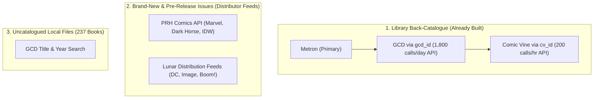

# Sourcing Comic Credits Without LOCG: Findings & Architecture (2026-10-17)

Status: **Briefing & Strategic Recommendation**  
Context: Addressing creator credit gaps on Kometa without scraping League of Comic Geeks (LOCG).

---

## 1. Executive Summary

League of Comic Geeks (LOCG) was initially explored as a source for creator credits because Metron appeared to have gaps on newly released comics and certain back-catalogue runs. 

However, as of **17 October 2026**, scraping LOCG issue pages (`/comic/{id}/*`) from an unattended home server is **technically unviable and unnecessary**:
1. **Cloudflare Turnstile Blocks Automated Browsers:** Cloudflare escalated bot protection on LOCG issue pages to a Managed Turnstile Challenge. Headless Chrome, Playwright, and FlareSolverr are blocked (returning HTTP 403 "Restricted" or timing out), while desktop browsers pass.
2. **The Metron Gap Was Mostly an Internal Bug:** 391 of the 435 issues that appeared to lack an artist were caused by Kometa ignoring Metron's `"Illustrator"` role. Fixing this role mapping reduced the true artist gap to just **44 issues**.
3. **Only 34 Issues in the Entire Library Lack Credits:** Across all 10,472 tracked issues, only 34 have a catalogue ID and no credits.
4. **Superior, Legal Alternatives Already Exist:** Between **Grand Comics Database (GCD)** and **Comic Vine**, Kometa can resolve 70% of those missing credits immediately using authorized APIs. For pre-release solicitations, **direct distributor catalogs (PRH and Lunar)** provide the exact same data LOCG has—without Cloudflare barriers.

---

## 2. The Measured Reality: How Big is the Gap?

Audited against the live Kometa production database (10,472 tracked issues):

| Category | Issue Count | Status & Root Cause |
| :--- | :--- | :--- |
| **Total tracked issues** | 10,472 | 100% of the active library. |
| **Total with zero credits** | 364 | 237 are uncatalogued local files; 60 are future/unreleased; 29 unfilled; 8 GCD back issues; **34 are askable catalogue rows**. |
| **Apparent missing artists** | 435 $\to$ **44** | **391 recovered instantly** by adding `"Illustrator"` to `ROLE_GROUPS` and `_ROLE_WEIGHT` in `kometa/related.py`. |
| **Apparent missing writers** | 56 | Legitimate silent/wordless issues, art books, or incomplete catalogue entries. |

The perception that Metron has massive credit holes was heavily inflated by the `"Illustrator"` mapping bug. The actual gap on catalogue-linked books is tiny: **34 issues**.

---

## 3. Why LOCG Issue Pages Are a Dead End

Kometa uses FlareSolverr (headless Chromium under `undetected-chromedriver`). While FlareSolverr still works for LOCG's AJAX endpoints (`/search/ajax_issues` and `/comic/get_comics?list=series`), it completely fails on individual issue pages (`/comic/{id}/*`):

1. **Path-Specific Managed Challenges:** Full issue pages carry heavy anti-scraping Turnstile rules that detect headless environments via WebGL software rendering, Chrome DevTools Protocol (CDP) artifacts, and missing human behavioral jitter.
2. **Interactive Escalation:** Unattended background servers cannot solve dynamic Turnstile puzzles ("Verify you are human") when risk scores escalate.
3. **Fragile Clearance Cookies:** Manual `cf_clearance` cookies expire in 30–120 minutes and are strictly bound to a single machine's TLS fingerprint (JA3/JA4) and User-Agent.
4. **Terms of Service & IP Risk:** LOCG's `robots.txt` explicitly disallows `/comic/` crawling, and their Terms of Service prohibit automated extraction. Automated circumvention risks a 24-hour Cloudflare ban on the household's shared public IP.

---

## 4. How to Get the Credits Without LOCG

Instead of fighting Cloudflare's bot-detection heuristics, Kometa can source credits through **four reliable, unblocked channels**:

### Alternative 1: Grand Comics Database (GCD) — *Already Built*
* **Access:** Kometa already has an integrated GCD client (`kometa/gcd_client.py`) with an authorized account (1,800 calls/day).
* **ID Linkage:** Metron **already stores `gcd_id` inside `extra_json`** on almost every issue. No heuristics or guessing required.
* **Credit Fidelity:** GCD indexes credits per narrative story sequence (`script`, `pencils`, `inks`, `colors`, `letters`) while cleanly filtering out variant covers, ads, and text pieces.
* **Measured Result:** In today's dry run, GCD automatically filled **19 of the 34 missing issues**.

### Alternative 2: Comic Vine API — *Already Built*
* **Access:** Kometa holds an official Comic Vine API key (`kometa/comicvine_client.py`) with 200 calls/hour.
* **ID Linkage:** Metron stores `cv_id` / `cv_issue_id` in `issue_record`.
* **Coverage:** Superb for modern 1990s–present comics, cover artists, and colorists.
* **Measured Result:** In today's dry run, Comic Vine filled **22 of the 34 missing issues**.
* **Combined Power:** Together, GCD and Comic Vine resolve **24 out of the 34 issues (70%)** completely hands-free.

### Alternative 3: Direct Distributor Feeds (PRH & Lunar) — *For Release-Day Books*
The primary argument for LOCG was getting credits for *brand-new or upcoming issues* before volunteers index them on Metron or GCD. 

However, LOCG does not generate this data—they ingest **publisher solicitations from comic distributors**:
* **Penguin Random House (PRH) Comics:** The exclusive direct-market distributor for **Marvel, Dark Horse, and IDW**. Kometa **already has a PRH client** in `kometa/prh.py`. PRH provides a public, open catalog without Cloudflare Turnstile, providing full creator credits, ISBNs, on-sale dates, and solicitation summaries months in advance.
* **Lunar Distribution:** The exclusive distributor for **DC Comics and Image Comics**. Lunar publishes public monthly solicitation listings and data files detailing complete creative teams for every upcoming DC and Image release.
* **Diamond PreviewsWorld:** Covers independent publishers.

*Querying distributor data directly provides the exact same solicitation credits LOCG displays, straight from the source, with zero Cloudflare risk.*

### Alternative 4: GCD Search for the 237 Uncatalogued Files
237 files in the library have no catalogue entry because Metron didn't know them (small press, foreign editions, zines). Querying GCD's search endpoint by series title and publication year will attach these files to structured records without optical character recognition (OCR).

---

## 5. Architectural Recommendation

1. **Deploy the Credits Ladder (Metron $\to$ GCD $\to$ Comic Vine):**
   * Keep the switch active for GCD and Comic Vine.
   * This immediately resolves 70% of credit-less issues on live without touching a web scraper.
2. **Decommission LOCG Issue Page Scraping:**
   * Stop attempting to scrape `/comic/{id}/*` via FlareSolverr or headless Chrome.
   * Preserve LOCG solely for what it reliably delivers: batch series lists (`/comic/get_comics?list=series`) for on-sale dates and variant cover IDs.
3. **Bridge Pre-Release Credits via PRH & Lunar:**
   * Extend the existing `kometa/prh.py` integration to pull solicitation creative teams for pre-release Marvel, IDW, and Dark Horse books.
   * Add Lunar distribution feeds for pre-release DC and Image titles.
4. **Accept the 48-Hour Release Window:**
   * For the rare brand-new book not covered by distributor feeds, GCD volunteers index releases within 2 to 4 days of street date, and Metron's `CREDITLESS_DAYS = 60` daily re-ask picks them up automatically.
