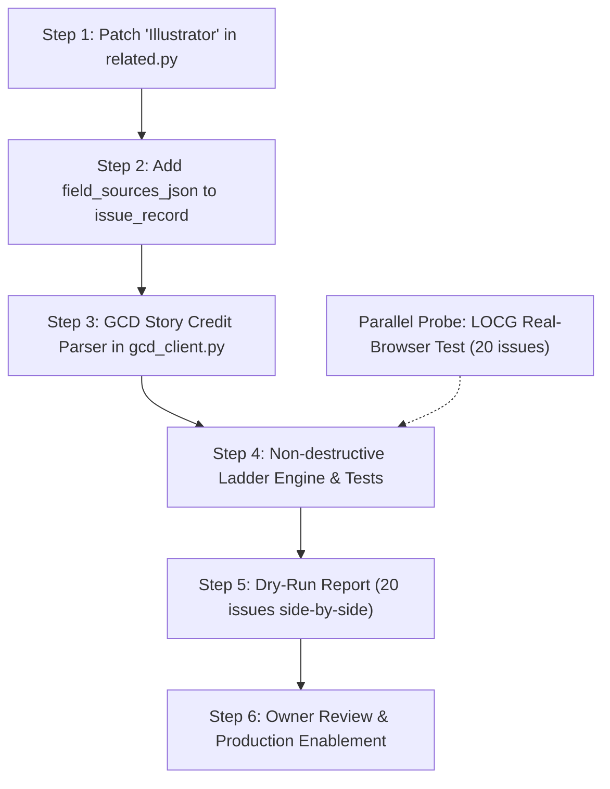

# Credits Sourcing Design Review (2026-10-17)

Status: **Review & Alignment**  
References: 
- `docs/credits-sourcing-design-2026-10-17.md`
- `docs/data-consistency-problem-2026-10-17.md`
- `docs/consistent-comic-data-plan-2026-10-17.md`

---

## 1. Executive Summary & Verdict

The design proposed in `docs/credits-sourcing-design-2026-10-17.md` is **approved with specific implementation guidance**. 

Narrowing the scope strictly to **creator credits** while adopting a non-blending single-rung rule (`Metron > GCD > Comic Vine > LOCG > file tags`) is the right architectural decision. It avoids the severe data-corruption risks of person-by-person merging (name variants, pseudonyms, inconsistent role taxonomy, duplicate creator pages) while solving the immediate gap of 364 credit-less records across the 10,472 tracked issues.

---

## 2. Answers to Section 11 Questions

### Q1: Rank — Is GCD above Comic Vine right for all issues, or only new ones (by ID availability)?

**Answer: Rank GCD above Comic Vine across the board (`Metron > GCD > Comic Vine > LOCG > file tags`).**

1. **Granularity (Story vs. Issue Level):**
   - **GCD** indexes credits per narrative sequence/story. Kometa can cleanly extract actual comic story credits (`script`, `pencils`, `inks`, `colors`, `letters`) while discarding covers, variant covers, text articles, pin-ups, and advertisements.
   - **Comic Vine** operates strictly at the issue level (`person_credits`), aggregating all contributors without narrative story separation. This routinely introduces cover artists or variant cover contributors into main story credits.
2. **Determinism over Branching:**
   - A single, uniform ladder prevents split-brain branching logic based on issue age or publication cutoff dates.
3. **ID Availability & Seamless Fallback:**
   - For new releases, Metron populates `gcd_id` from day one, while `cv_id` is often delayed by days or weeks. Ranking GCD above Comic Vine means new releases resolve immediately.
   - For older back issues where both IDs exist, GCD's volunteer-indexed story-level credits are higher fidelity.
   - If an issue has no GCD credits or no `gcd_id`, the ladder automatically falls through to Comic Vine (by `cv_id` or volume + number).
4. **Rate Budget Isolation:**
   - GCD grants 1,800 calls/day; Comic Vine is strictly capped at 200 calls/hour. Hitting GCD first preserves the scarce Comic Vine hourly rate limit for series matching and story-arc lookups.

---

### Q2: Incomplete lists — (a) Leave them (one source per list), or (b) Fill the missing roles only?

**Answer: (a) Leave them as single-source lists now, after fixing the "Illustrator" role mapping.**

1. **The Invariant Holds:** Merging creator lists across catalogues person-by-person violates the cardinal rule of §5.1. It invites name collisions ("Jock" vs. "Mark Simpson", initials vs. full names), conflicting role naming, and fragmented person pages.
2. **The "Illustrator" False Positives:**
   - As identified in §2 and §8, Metron frequently assigns the role `"Illustrator"`.
   - In `kometa/related.py`:
     - `ROLE_GROUPS` omits `"illustrator"`, `"illustration"`, and `"illustrations"` from the `"artist"` group.
     - `_ROLE_WEIGHT` omits `"illustrator"`, `"illustration"`, and `"art"`.
   - Consequently, these creators were dumped into `"Other credits"` with weight `0.0`, masking valid artists as "missing".
3. **Course of Action:**
   - Patch the Illustrator role mapping immediately (Step 1).
   - Re-evaluate the live library to measure how many true missing-artist records remain.
   - Only consider Option (b) if a significant cluster of legitimate single-role gaps persists, and only under strict exact-name matching.

---

### Q3: The real-browser test for LOCG issue pages — Go ahead in parallel?

**Answer: Yes, proceed in parallel as an isolated diagnostic probe (no app code).**

1. **Unique Value:** LOCG is currently the only catalogue with solicitation credits available prior to street date.
2. **Isolation:** Running a standalone Playwright script with a persistent Chrome profile on a 20-issue sample outside the main application allows us to evaluate Cloudflare Turnstile behavior, challenge degradation, and latency without adding browser dependencies or memory bloat to the live Kometa service.
3. **Decision Criteria:**
   - **Pass:** $\ge 19/20$ pages load with structured credits, and FlareSolverr's shared IP pool does not get banned. LOCG becomes eligible as Rung 4.
   - **Fail:** Cloudflare flags or blocks the profile after repeated hits. We fail fast and avoid building an unstable scraping dependency into the core server.

---

### Q4: The 237 uncatalogued files — Matching to GCD first, or credits-page reading first?

**Answer: Match to GCD first; colophon OCR second.**

1. **High Value per Match:**
   - Matching a file to GCD anchors the comic to a structured catalogue entry (dates, series, volume, issue number, publisher, imprint, story synopses, and credits) in a single operation.
   - GCD has by far the most comprehensive index of indie, small press, underground, and international comics that Metron lacks.
2. **OCR Complexity & Limitations:**
   - Credits-page / colophon OCR requires detecting the correct page (indicia vs. credits box vs. intro), runs heavy vision/OCR models, is prone to transcription errors on stylized comic lettering, and yields unlinked raw text strings without dates or catalogue IDs.
   - Colophon OCR should serve as the fallback of last resort for self-published zines or obscure releases not indexed in GCD.

---

## 3. Review of Section 8 Corrections

| Point in §8 | Analysis & Alignment |
|---|---|
| **Credits ladder: Metron → GCD → Comic Vine** | Fully endorsed. Metron stores `gcd_id` from day one, giving immediate access. |
| **`issue_status.store_date` write requirement** | **Critical catch.** All UI endpoints (`On Deck`, `Series`, `Sheet`) join against `issue_status.store_date`. Any background worker updating `store_date` must write synchronously to both `issue_record` and `issue_status`. |
| **LOCG lists pagination & reliability** | Confirmed. LOCG lists paginate in chunks of 140. Given the recent FlareSolverr HTML-escaping fix, back-catalogue date accuracy must be verified before relying on it for mass date backfills. |
| **Page count utility** | Agreed. The reader, OPDS feeds, and file lists already compute page count directly from the archive file on disk; storing it in `issue_record` is low-value. |
| **"Illustrator" role mapping** | Immediate bugfix required in `kometa/related.py`. |

---

## 4. Technical Architecture Specifications

### 4.1 Schema Extension (`issue_record`)

Add `field_sources_json TEXT` to `issue_record`:

```sql
ALTER TABLE issue_record ADD COLUMN field_sources_json TEXT;
```

- **Format:** JSON object tracking provenance per field:
  ```json
  {
    "credits": {
      "source": "gcd",
      "at": "2026-10-17T09:00:00Z"
    }
  }
  ```
- **Backwards Compatibility:** If `field_sources_json` is `NULL` or missing `"credits"`, provenance defaults to `{"source": issue_record.source, "at": issue_record.fetched_at}`. No mass migration of existing records is required.
- **Replacement Invariant:**
  - `Metron > GCD > Comic Vine > LOCG > file tags`
  - A higher rung replaces a lower rung.
  - A lower rung **never** overwrites a higher rung.
  - An empty result **never** clears an existing list.

### 4.2 GCD Story Credit Extractor

In `kometa/gcd_client.py`:
- Filter story sequences to comic stories only (type: `"comic story"`, `"story"`, or sequences with non-empty script/pencils; ignore `"cover"`, `"text article"`, `"promo"`, `"ad"`).
- Parse narrative fields: `script`, `pencils`, `inks`, `colors`, `letters`.
- Clean credit strings: strip notes like `"(credited)"`, `"(signed as ...)"`, and bracketed notations.
- Deduplicate creators across multi-story issues (e.g. anthologies) while preserving distinct roles.
- Map to Kometa credit format: `[{"name": "...", "role": "writer"}, {"name": "...", "role": "artist"}, ...]`.

### 4.3 Creator Link Resolution

GCD and Comic Vine deliver names as text strings. When rendered:
- Pass names through `related.with_creator_ids()`.
- Metron IDs are assigned via the local name shelf or cached single-name lookups, preserving clickable creator links and "More from" recommendations.

---

## 5. Implementation Roadmap



1. **Step 1 (Immediate Quick Win):**
   - Update `ROLE_GROUPS` and `_ROLE_WEIGHT` in `kometa/related.py` to include `"illustrator"`, `"illustration"`, `"illustrations"`, `"art"`.
   - Add unit tests verifying illustrator role grouping and weights.
2. **Step 2 (Schema):**
   - Add `field_sources_json` column handling in `kometa/record.py:ensure_tables()`.
3. **Step 3 (Parser):**
   - Build and test `gcd_client.extract_story_credits(issue_data)` using recorded multi-story fixtures.
4. **Step 4 (Ladder Logic):**
   - Implement credit ladder fall-through in `kometa/record.py`.
   - Ensure rate budget safeguards (`gcd_client.budget()`, Comic Vine limiter).
5. **Step 5 (Dry Run Report):**
   - Generate a side-by-side comparison report across 20 credit-less issues showing Metron vs GCD vs Comic Vine output.
6. **Parallel Diagnostic:**
   - Execute the 20-issue Playwright test script against LOCG issue pages to verify Cloudflare bypass feasibility.
